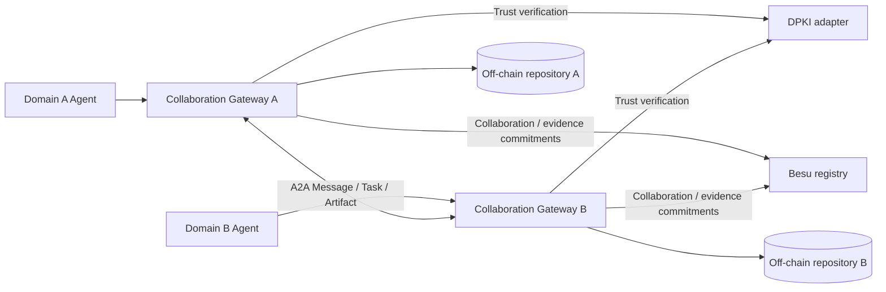

# Research architecture (design, not yet deployed)

## Planned trust boundaries
1. Verify domain and agent identity using real DPKI certificate chain/status evidence, not merely a self-declared Agent Card.
2. Explicitly authorize collaboration membership; resource access requires separate policy enforcement.
3. Exchange data and task outputs off-chain using official A2A 1.0 protocol bindings.
4. Anchor minimal signed event commitments and collaboration state on Besu. No raw payload, secrets, or personal information on-chain.
5. Compare retrieved content to SHA-256 digest and verify provenance/signature and ordered event commitments.
6. Define replay defense, time/finality model, and failure recovery before deployment.

## Implementation status
- Local, in-memory reference lifecycle and tamper-evident evidence hash chain: implemented.
- Test-only verifier fixture: implemented; default fail closed.
- Real DPKI adapter, A2A transport, Besu smart contract, Docker and benchmarks: **not implemented**.

## Paper evaluation
Baseline A2A-only versus A2A + collaboration gateway + Besu. Measure establishment latency, data/artifact exchange latency, proof verification time, number of participating domains, tamper rejection and storage overhead. Report actual measurements only.
